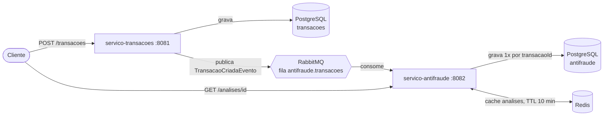

# Antifraude: projeto final do módulo 3

**Perfil de execução: A (Docker)**

## O que o sistema faz

Recebe transações financeiras e decide, de forma assíncrona, se cada uma é **APROVADA** ou **REPROVADA**:

1. O **servico-transacoes** recebe a transação (`POST /transacoes`), grava no seu banco e manda uma mensagem para a fila.
2. O **servico-antifraude** recebe a mensagem, aplica as regras e grava o resultado no seu banco. Se a mesma mensagem chegar duas vezes, ele grava uma vez só.
3. O resultado é consultado em `GET /analises/{transacaoId}`, com **cache no Redis**.

Regras de análise (configuráveis em `servico-antifraude/src/main/resources/application.yml`):
- valor acima de R$ 5.000,00 → REPROVADA;
- 3 ou mais transações da mesma conta de origem nos últimos 5 minutos → REPROVADA;
- em qualquer outro caso → APROVADA.

## Desenho dos serviços



## Organização do código

Os dois serviços seguem as mesmas camadas ([ADR 0003](docs/adr/0003-arquitetura-em-camadas.md)):

```
br.com.ada.<servico>
├── api/             controller, dto (request), handler (exceção → HTTP)
├── application/     service (casos de uso), dto, port (interfaces de saída)
├── domain/          model (entidades), service (regras puras), exception
└── infrastructure/  persistence (Spring Data), messaging (RabbitMQ), config
```

## Como rodar (perfil A)

```bash
docker compose up -d --build
```
